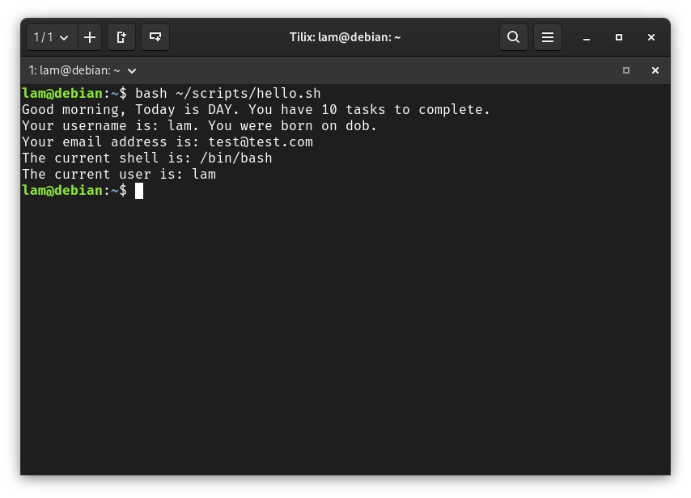

# Notes 4 

## Question 1
How to install and remove using the APT command. Include several well documented examples as you will need to install software later.
* APT is an Advanced Package Tool used for managing Debian packages.
* Programs can easily be installed or removed by adding the package name with a space between. 
* The install option installs specified packaged 
* The remove option removes the specified package. 

### Examples

* sudo apt install firefox flameshot caffeine -y
* sudo apt remove firefox flameshot caffeiene -y

## Question 2
  How to create a shell script step by step including screenshots and how to run it. Try to be as detailed as possible. You will have to create a scripts in your final exam. 
  * Shell scripts is created through the genome's editor, than executed through the shell.
    1. Open the genome editor.
    2. save the file script.sh
    3. The first line has to be the interpreter. In this case of bash its: #!/bin/bash
    4. The rest of the script includes the commands you want the shell to execute when the file is run. 
    5. To run the script, te command is bash /path/to/script/script_name.sh
   
   ### Example
 #!/usr/bin/env bash
numb_tasks=10
dob="01/01/2001"
email="test@test.com"
echo "Good morning, Today is DAY. You have $numb_tasks tasks to complete."
echo "Your username is: $USER. You were born on dob."
echo "Your email address is: $email"

echo "The current shell is: $SHELL"
echo "The current user is: $USER"
